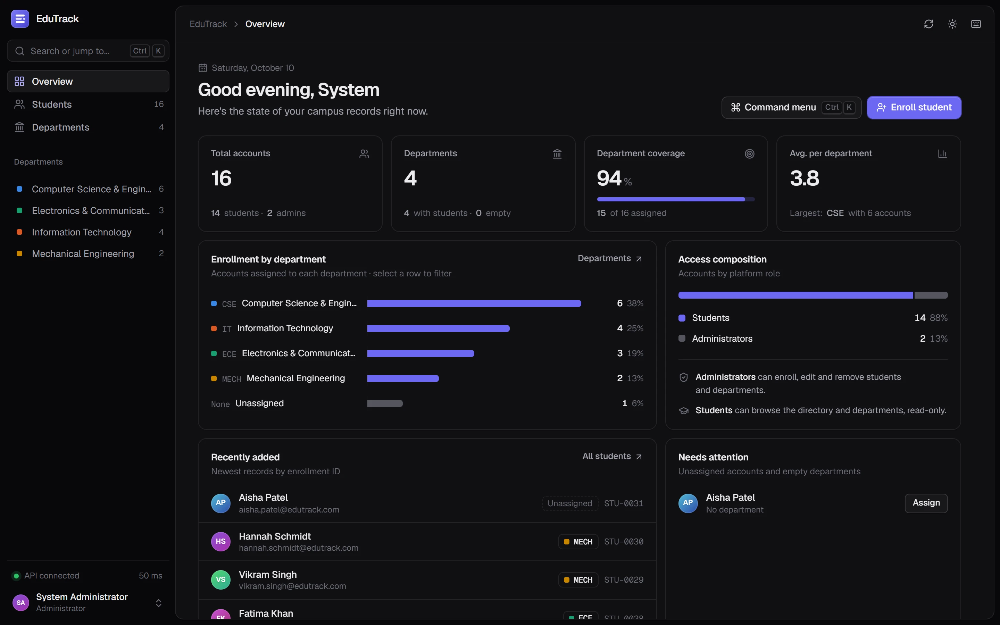
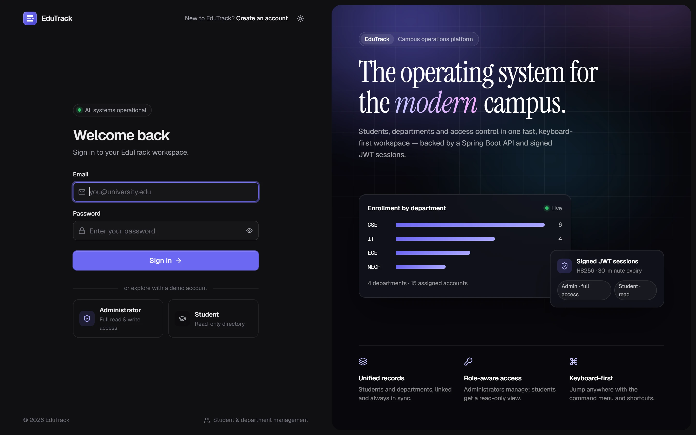
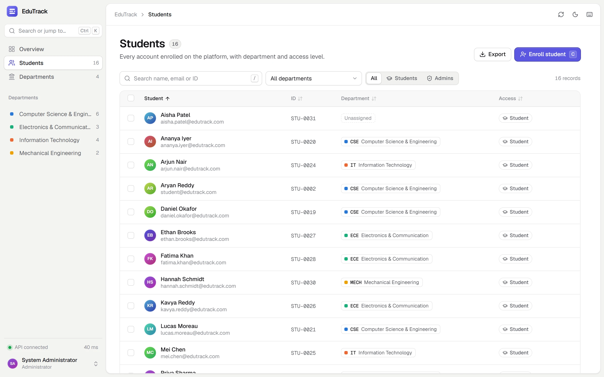
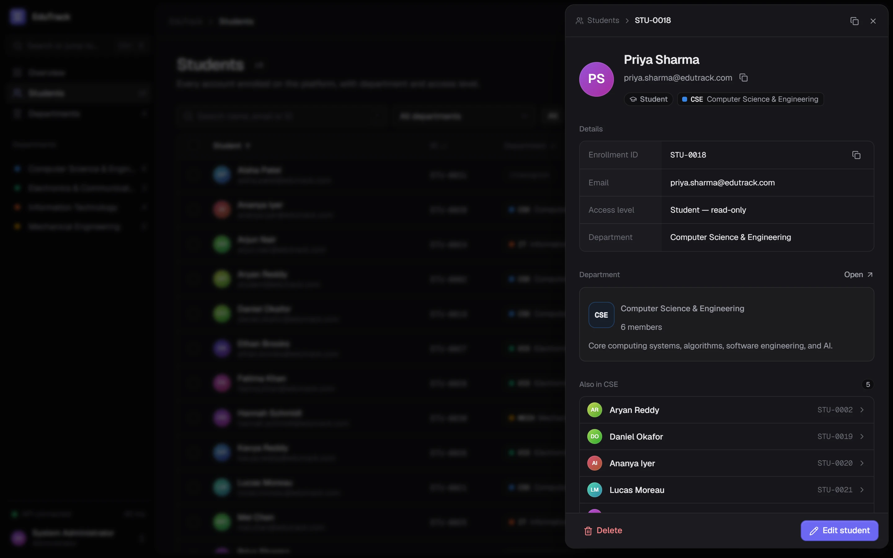
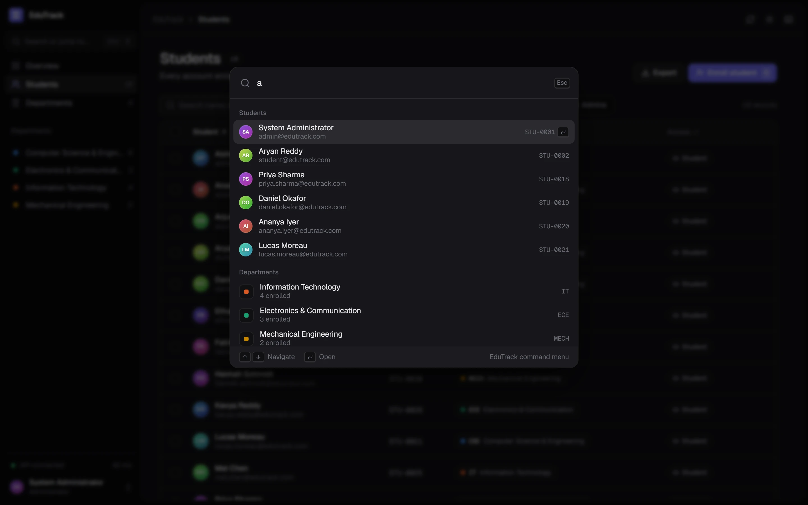
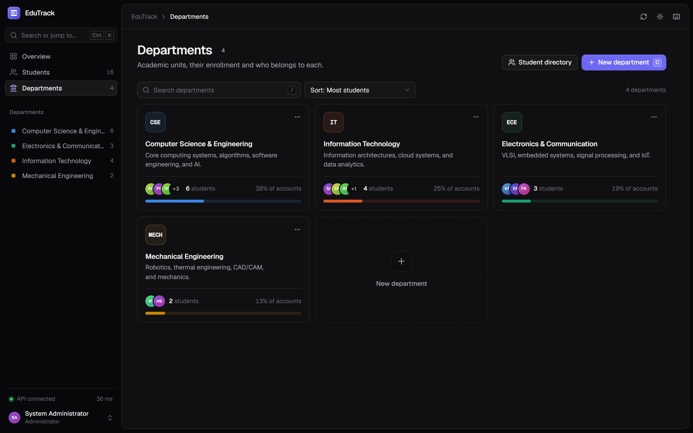
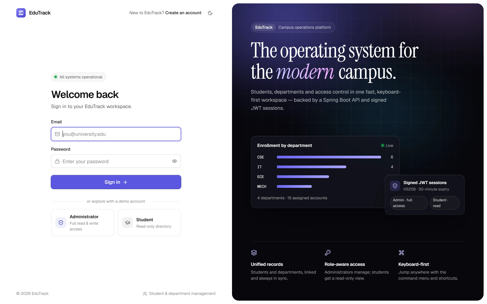
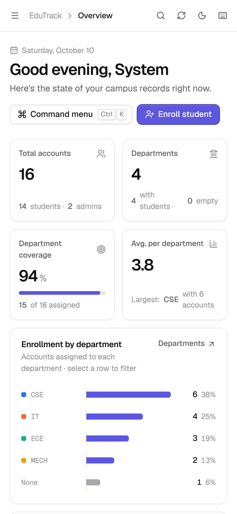
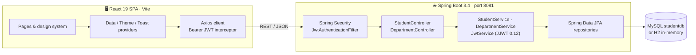

<div align="center">


# EduTrack

**The operating system for the modern campus.**

A full-stack student & department management platform — a keyboard-first React 19 workspace on top of a Spring Boot 3 REST API with JWT authentication.

<p>
  
  
  
  
  
  
  
</p>

<a href="#-quick-start"><b>Quick start</b></a> ·
<a href="#-features"><b>Features</b></a> ·
<a href="#-screenshots"><b>Screenshots</b></a> ·
<a href="#-architecture"><b>Architecture</b></a> ·
<a href="#-rest-api"><b>API</b></a>

<br /><br />

<picture>
  <source media="(prefers-color-scheme: dark)" srcset="docs/screenshots/overview-dark.webp" />
  <source media="(prefers-color-scheme: light)" srcset="docs/screenshots/overview-light.webp" />
  
</picture>

</div>

---

## ✨ Features

<table>
<tr>
<td width="50%" valign="top">

### 📊 Live overview
Headline metrics, enrollment by department, access composition, recently added records and a **Needs attention** queue (unassigned students, empty departments) with one-click assignment — every number is derived from real API data.

</td>
<td width="50%" valign="top">

### 👥 Student directory
Search by name, email or ID · filter by department & role · sortable columns · pagination · **multi-select bulk move & delete** · CSV export · filters live in the URL, so every view is shareable.

</td>
</tr>
<tr>
<td valign="top">

### 🏛️ Departments
Colour-coded department cards with enrollment share, member avatars and a detail panel listing every member. Deleting a department with students requires **type-to-confirm**.

</td>
<td valign="top">

### ⌘ Keyboard-first
A global **command menu** (<kbd>Ctrl</kbd>/<kbd>⌘</kbd>+<kbd>K</kbd>) searches students, departments and actions. Shortcuts for everything: <kbd>/</kbd> search, <kbd>C</kbd> create, <kbd>G</kbd> <kbd>S</kbd> go to students, <kbd>?</kbd> help.

</td>
</tr>
<tr>
<td valign="top">

### 🔐 Role-aware & session-safe
Signed **JWT** sessions with BCrypt-hashed passwords. Administrators manage records; students get a read-only workspace. The client enforces the 30-minute token expiry with a warning before sign-out.

</td>
<td valign="top">

### 🎨 Crafted UI
Hand-built design system — light & dark themes (with a circular reveal), native `<dialog>` sheets, Popover-API menus, toasts, skeleton loading, empty & error states, and a responsive layout down to phone width.

</td>
</tr>
</table>

## 📸 Screenshots

<table>
<tr>
<td width="50%"><p align="center"><sub><b>Sign in</b> — live API status & enrollment preview</sub></p></td>
<td width="50%"><p align="center"><sub><b>Student directory</b> — search, filters, bulk actions</sub></p></td>
</tr>
<tr>
<td><p align="center"><sub><b>Detail panel</b> — profile, department, classmates</sub></p></td>
<td><p align="center"><sub><b>Command menu</b> — jump anywhere with <kbd>Ctrl</kbd>+<kbd>K</kbd></sub></p></td>
</tr>
<tr>
<td><p align="center"><sub><b>Departments</b> — enrollment share & members</sub></p></td>
<td><p align="center"><sub><b>Light theme</b> — follows your system, or pin either</sub></p></td>
</tr>
</table>

<p align="center">
  <br />
  <sub><b>Responsive</b> — the full workspace on a phone</sub>
</p>

## 🚀 Quick start

**Prerequisites:** Java 21 · Node.js 20+ · (optional) MySQL 8 on port 3306

```bash
git clone https://github.com/RIPJAW1316/edutrack.git
cd edutrack
```

**1 · Start the API** (port 8081, in-memory H2 database — no setup needed)

```bash
cd cs
./mvnw spring-boot:run -Dspring-boot.run.profiles=h2      # Windows: .\mvnw.cmd ...
```

> Drop `-Dspring-boot.run.profiles=h2` to use MySQL (`studentdb`, configured in `cs/src/main/resources/application.properties`).

**2 · Start the web app** (port 5173)

```bash
cd frontend
npm install
npm run dev
```

Open **http://localhost:5173** — on Windows you can also double-click `start-backend.bat` then `start-frontend.bat`.

### 🔑 Demo accounts

Seeded automatically on first start — or use the one-click demo cards on the sign-in screen.

| Role | Email | Password | Access |
| :-- | :-- | :-- | :-- |
| 🛡️ Administrator | `admin@edutrack.com` | `admin123` | Full read & write |
| 🎓 Student | `student@edutrack.com` | `student123` | Read-only |

## ⌨️ Keyboard shortcuts

| Shortcut | Action | | Shortcut | Action |
| :-- | :-- | :-- | :-- | :-- |
| <kbd>Ctrl</kbd>/<kbd>⌘</kbd> <kbd>K</kbd> | Command menu | | <kbd>G</kbd> <kbd>O</kbd> | Go to Overview |
| <kbd>/</kbd> | Focus search | | <kbd>G</kbd> <kbd>S</kbd> | Go to Students |
| <kbd>C</kbd> | Create in current view | | <kbd>G</kbd> <kbd>D</kbd> | Go to Departments |
| <kbd>?</kbd> | Show all shortcuts | | <kbd>G</kbd> <kbd>A</kbd> | Go to Account |

## 🧭 Architecture



| Layer | Stack |
| :-- | :-- |
| **Frontend** | React 19, Vite 6, React Router 7 (data router + view transitions), Axios, lucide-react icons, hand-written CSS design system (no UI framework) |
| **Backend** | Spring Boot 3.4.3, Java 21, Spring Security 6, JJWT 0.12.6, Spring Data JPA / Hibernate, Bean Validation |
| **Data** | MySQL (`studentdb`) or H2 in-memory via the `h2` profile; demo data seeded by `DataInitializer` |

## 🔌 REST API

Base URL `http://localhost:8081` · Postman collection: [`Student_Management.postman_collection.json`](Student_Management.postman_collection.json)

| Method | Endpoint | Description |
| :-- | :-- | :-- |
| `POST` | `/students/login` | Authenticate → `{ token, id, email, role }` |
| `POST` | `/students/register` | Create an account |
| `GET` | `/students` | List students (with department name & code) |
| `GET` | `/students/{id}` | Get one student |
| `GET` | `/students/department/{departmentId}` | Students in a department |
| `PUT` | `/students/{id}` | Update a student |
| `DELETE` | `/students/{id}` | Delete a student |
| `GET` | `/departments` | List departments (with enrolled count) |
| `GET` | `/departments/{id}` | Get one department |
| `POST` | `/departments` | Create a department |
| `PUT` | `/departments/{id}` | Update a department |
| `DELETE` | `/departments/{id}` | Delete a department (students are unassigned, not deleted) |

## 📁 Project structure

```text
edutrack/
├── cs/                              # Spring Boot API
│   └── src/main/java/com/anurag/cs/
│       ├── config/                  # SecurityConfig, JwtAuthenticationFilter, DataInitializer
│       ├── controller/              # StudentController, DepartmentController
│       ├── service/                 # StudentService, DepartmentService, JwtService
│       ├── entity/ · dto/ · enums/ · repository/ · exception/
├── frontend/                        # React 19 + Vite SPA
│   └── src/
│       ├── api.js                   # Axios client + JWT interceptors
│       ├── layout/                  # App shell, command menu, shortcuts
│       ├── pages/                   # Overview, Students, Departments, Account, auth/
│       ├── components/              # Dialog, Menu, side sheets, charts, UI primitives
│       ├── providers/               # Theme, toast and data providers
│       ├── lib/                     # Session (JWT), hotkeys, formatting
│       └── styles/                  # Design tokens, base, components, layouts
├── docs/screenshots/
├── start-backend.bat · start-frontend.bat
└── Student_Management.postman_collection.json
```

📄 Project documents: [Project abstract](EduTrack_Project_Abstract.pdf) · [Architecture flowchart](EduTrack_Architecture_Flowchart.pdf)

## 🛣️ Roadmap

- [ ] Enforce roles server-side (`@PreAuthorize`) and require a valid JWT on protected routes — role checks currently live in the UI
- [ ] Return `400` for validation errors and add a unique constraint on student email
- [ ] Move the JWT signing key and DB credentials to environment variables
- [ ] Restrict self-registration to the `STUDENT` role
- [ ] Allow un-assigning a student's department via `PUT /students/{id}`

---

<div align="center">
<sub>Built with React, Spring Boot and a lot of attention to detail · <a href="https://github.com/RIPJAW1316">@RIPJAW1316</a></sub>
</div>
